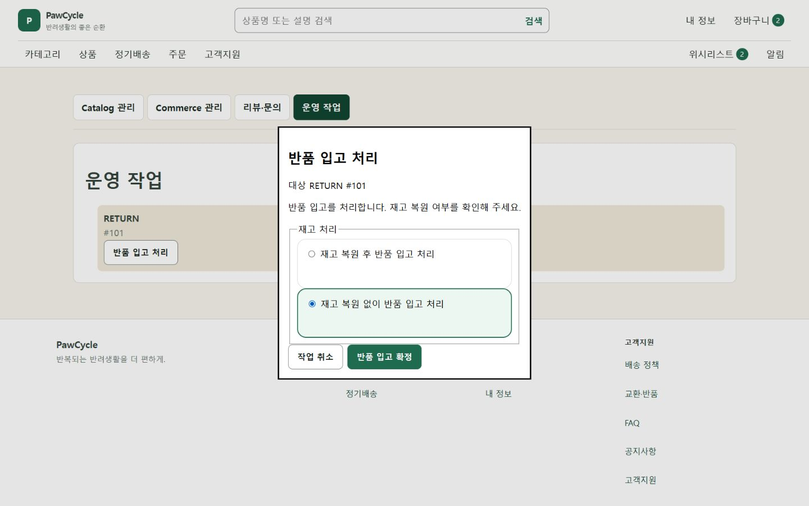

# ADMIN-RETURN-013 — 반품 입고 취소 안전성

2026-11-01 · 고위험 · 저장소 변경 · 기준 main c55e0a57f1efa09a604c78f517db527196781137

## 목적

PR #493에서 반품 입고 취소·동시 실행과 응답 유실을 안전하게 구분하고, 재고 반영을 추측하거나 자동 POST 재실행을 하지 않도록 한다.

## 결과

- RECEIVE_RETURN의 browser confirm을 명시적 확인 dialog로 교체. 재고 복원/복원 안 함을 radio로 선택하고 입고 확정과 작업 취소를 분리.
- 대상 reference ID 표시, 취소 초기 focus, native dialog와 Escape. 서버 payload와 availableActions 유지.
- 동기적으로 잠기는 executor가 완료 전 중복 실행을 차단. 취소(null)는 요청하지 않음. 실패 후 명시 재시도 가능.
- 기존 action명의 한국어 label. 고객 theme 적용 없음.

## 검증

- lint: 0 errors, 기존 6 warnings. typecheck PASS. npm test 185/185 PASS (추가 executor 회귀 2개).
- lockfile 그대로 독립 설치 후 npm run build PASS. 초기 외부 junction build 실패는 설치로 해결.
- Chrome 1440×900, loopback 합성 Admin fixture: 재고 복원 안 함을 선택하고 취소 → 요청 기록 [].
- 입고 확정 빠른 두 번 클릭 → [{restock:false}] 1건. 이어 재고 복원 확정 → {restock:true} 1건 추가.
- 모든 요청은 fixture 메모리에만 기록. 실제 Backend/재고/반품/결제 처리 없음.

## 위험·제한

실제 관리자 권한/서버 transaction·재고 상태 전이, 전체 예외 응답은 미검증. API·업무 정책 변경 없음. 복구는 이 Admin commit의 일반 revert PR. Production 조작 없음.

## 최종 Correction

- C1: Validator를 변경하지 않고 PR 필수 label과 보고서 목적/결과/위험 구획을 보완.
- C3: executor의 동기 busy 상태로 취소·Escape·Overlay 닫기를 잠금. 응답 유실/5xx/timeout은 처리 결과 확인 필요로 표시하고 같은 화면에서 해당 입고 POST를 차단.
- 서버의 명시적 4xx 거절 및 POST 이전 CSRF 획득 실패는 정상 실패로 처리하여 사용자 명시 재시도 가능. 자동 POST 재실행 없음.
- 기존 Operation 응답은 반품 referenceId만 제공하며 정확한 입고·재고 결과를 확정할 GET이 없어 별도 관리자 확인 안내. 목록에서 action이 사라진 것만으로 성공을 주장하지 않음.
- 불명확 상태의 차단은 현재 화면 lifetime에 한정된다. 새로고침·다른 관리자 세션의 확정 상태는 서버/관리자 확인이 필요하다. Backend의 APPROVED 확인 및 재고·입고 transaction 경계 유지.
- 응답 유실 뒤 재POST 0건, 5xx/408 불명확, 명시 거절 후 잠금 해제, 동기 닫기 차단 회귀 4개 추가. 이번 correction의 브라우저 재검증은 미실행.

CodeRabbit 리뷰: 사용자 승인에 따른 PR별 예외. 리뷰 미실행. 필수 CI 및 ChatGPT 독립 검토는 유지.

## 병합 순서와 Fixture

Admin #493을 먼저 검토한다. 두 브랜치의 visual-fixture.mjs 수정은 독립 유지한다. 이후 #492에 main을 일반 merge할 때 My 부분 오류와 Admin 입고 기록을 모두 보존하고 관련 회귀·Validator·Frontend gate를 다시 수행한다. rebase/force push/PR 직접 병합은 수행하지 않는다.

## Correction 검증 결과

- 기존 Task artifact Validator: 수정된 실제 PR 본문을 UTF-8 stdin으로 입력하여 PASS. Validator 수정 없음.
- npm run lint: PASS (0 errors, 기존 6 warnings). npm run typecheck: PASS.
- npm test: 189/189 PASS. npm run build: PASS.
- 이번 correction의 브라우저/실서버/Production 검증은 미실행. 최초 구현 캡처와 검증 기록은 당시 HEAD 근거로 보존. 최신 CI 상태는 PR에서 확인.

공유 fixture의 git merge-file 3-way 사전 검사에서 충돌 구획 2곳을 확인했다. 실제 브랜치/working tree merge는 수행하지 않았다. 일반 merge 시 summaryError·My 주문 요약 오류 분기와 receiptRequests·Admin 조회/입고 기록 분기를 모두 유지해야 한다.
