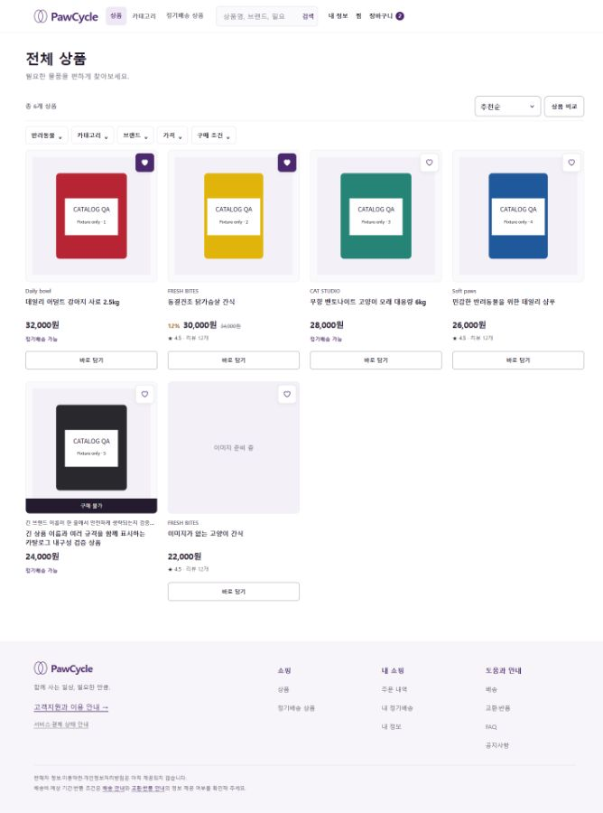
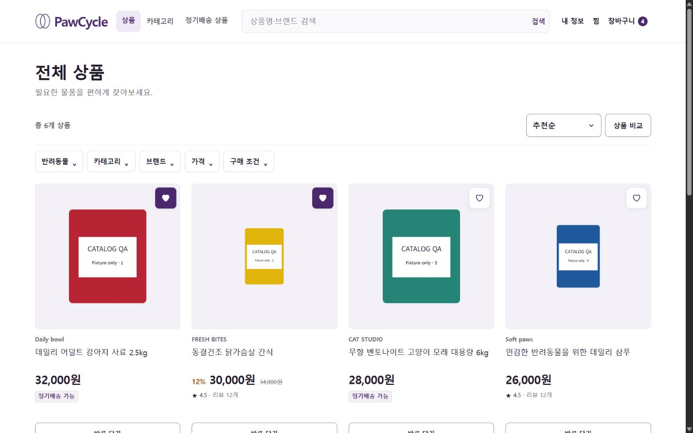
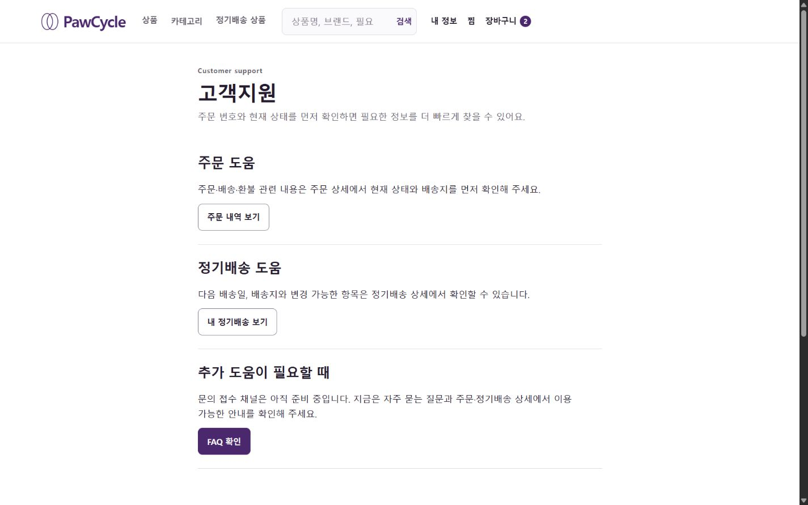
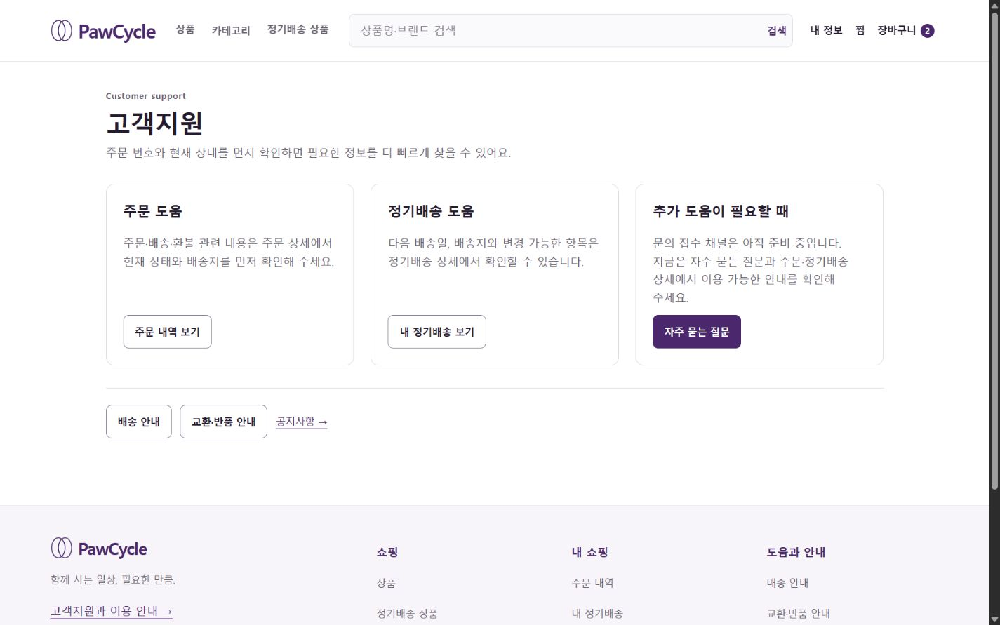

# UIUX-DESKTOP-465 — Desktop visual evidence

2026-10-26 · 일반 · 저장소 변경 · Issue #465 · 기준 main `9ec76bb559ca55ad3afdf83b025985902eaa0016`

## 목적

G0 기준선과 G7 공개 화면 검증 중 리뷰에서 직접 확인할 before/after만 보존한다. Chrome의 CSS viewport는 1440×900이며, 모든 상품·세션은 `frontend/scripts/visual-fixture.mjs`의 합성 응답이다. 실제 상품·혜택·정책 또는 실제 인증/결제 검증 근거가 아니다.

| 화면 | 기준선 관찰 / 유지 | 구현 Delta |
| --- | --- | --- |
| 공통 shell | 검색창 240px, 여러 CSS 파일의 반복 선언 / Daily Orbit 로고·색 유지 | 가변 검색, 88px/64px shell, 공통 selector 19개 통합 |
| 홈 | 상품 우선 구조와 정기배송 조회 유지 | 짧은 제목·카테고리 구획·상품 진열 위계 |
| 전체·정기배송 PLP / 비교 | 이미지 contain, 서버 가격·상태·URL 유지 | 4열, 이름·가격 정렬, 정기배송 제목, 비교 썸네일·개별 제거 |
| 정상·품절 PDP | 기존 gallery·옵션·CSRF·명시적 mutation 유지 | 수량→선택 가격→CTA, 중복 안내 축소, anchor, 최근 카드 재사용 |
| 지원·배송·반품·FAQ·공지 | 기존 사실과 정보 미제공 표현 유지 | 행동 카드, 조건/절차 구획, keyboard disclosure, 실제 이동 링크 |

## 결과 또는 증거

### PLP — before (full-page 축소 캡처)

### PLP — after

PLP Before는 screenshot API의 full-page 축소 출력이고 After는 viewport 출력이다. 같은 CSS viewport에서 실행했지만 이미지 픽셀 크기·표시 범위가 달라 높이의 직접 pixel diff 근거로 사용하지 않는다. 아래 고객지원은 같은 viewport 출력으로 비교한다.

상품명·가격·순서는 같은 합성 표본이다. After fixture에서는 2/4번 이미지의 세로/가로 비율도 stress 검증하도록 바꾸었으며, 장바구니 badge는 명시적 UI 검증 mutation으로 2→4가 되었다. 이 차이를 실제 상품 원본 교정이나 동일 이미지 조건의 개선 효과로 해석하지 않는다.

### 고객지원 — before

### 고객지원 — after

공개·비교 11개 경로를 1440×900 / 1280×800 / 1920×1080에서 확인한 33건의 DOM 가로 overflow는 0이었다. 카드 대표 표본은 contain 로딩, 48px 이름 영역, 같은 행 가격 top 일치를 확인했다. 검색·필터 URL·비교·옵션·수량·찜·gallery·합성 로그인 복귀와 성공/실패 UI를 확인했다. 상세 명령 결과와 후속 보정은 PR #466에 기록한다.

## 남은 위험

- Issue의 업로드 원본 9개는 열람하지 못했다. 위 캡처는 직접 실행한 로컬 기준선이다.
- 실제 taxonomy 전체/2-depth, 실제 서버 pagination, 이미지 원본 실패, 실제 인증·CSRF·결제사 통합은 미검증이다.
- G6 T18~T21은 실제 격리 계정·세션이 없어 Blocked / Unverified이다. 합성 로그인 성공으로 대체하지 않는다.
- G7의 독립 리뷰와 전체 Issue 종료는 미완료다. 자체 검토는 독립 리뷰가 아니다.
- 복구는 Frontend 변경의 일반 revert PR이다. Production 실행은 하지 않았다.
